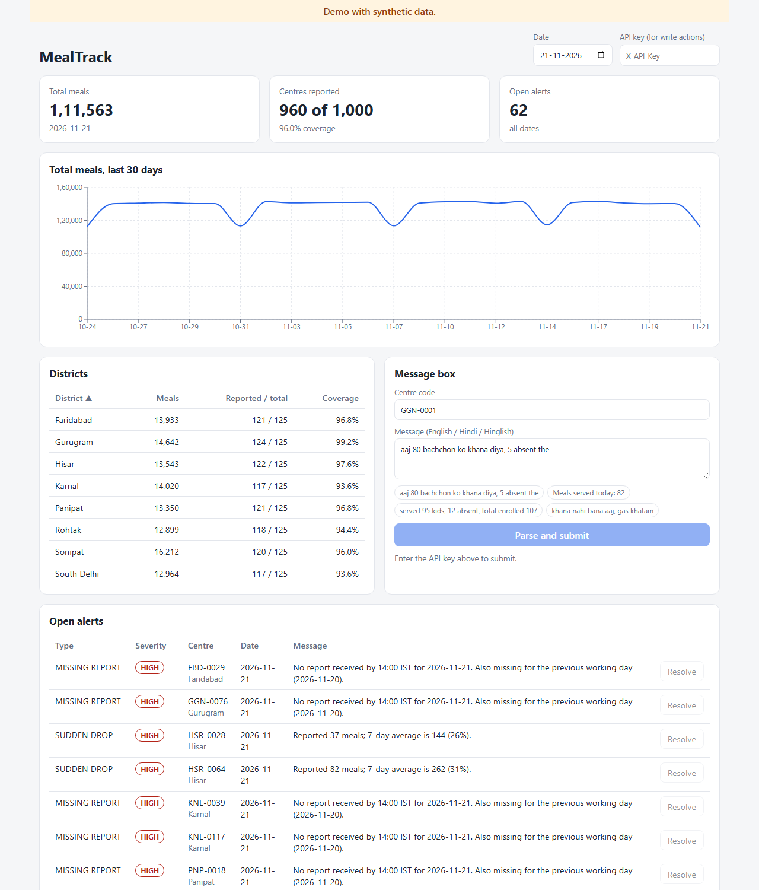
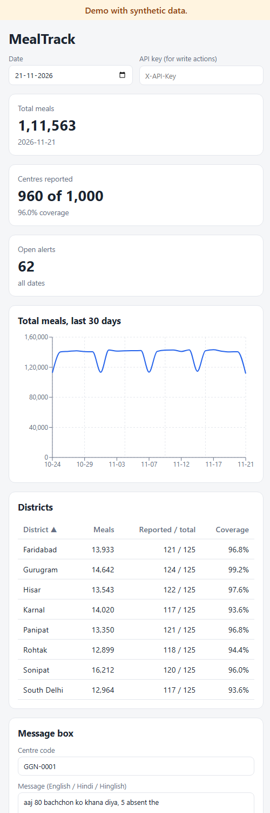

# MealTrack

Daily meal reporting and anomaly detection for school and Anganwadi feeding programs: a Spring Boot API, PostgreSQL, and a React dashboard.

> **Demo with synthetic data.** Every number in this project comes from a seed script. This is a portfolio project, **not affiliated with Feeding India**, and it contains no real centres or children. The ~1.4 lakh meals/day scale was chosen to mirror the scale described in the hiring post.

**Live demo:** _not deployed yet_ (see [Deployment](#deployment)).





## The problem

Feeding programs serve lakhs of meals every day, and the reports behind those meals arrive late, twice, mistyped, or not at all. A backend has to accept reports safely, notice bad or missing data, and show operators a clear picture each morning. MealTrack is a small, realistic version of that system.

## Architecture

```mermaid
flowchart LR
    D[Dashboard<br/>React + TS] -->|/api| A[REST API<br/>Spring Boot 3 / Java 21]
    A --> DB[(PostgreSQL 16<br/>Flyway migrations)]
    A --> RS[ReportService<br/>validate + idempotent upsert]
    A --> PS[ParseService]
    PS -->|optional| L[LlmClient<br/>Claude or Gemini]
    PS -->|on any failure| R[RuleBasedParser]
    RS --> AN[AnomalyService<br/>rule classes]
    J[MissingReportJob<br/>@Scheduled] --> AN
    A --> S[SummaryService]
```

Key design decisions:

- **Idempotent upsert.** `UNIQUE (centre_id, report_date)` means one report per centre per day; resubmitting updates the row (201 first time, 200 after). Two simultaneous submissions race on the constraint: the loser catches the violation and retries as an update. A concurrency test with 12 threads covers it.
- **Rule-based anomaly detection with configurable thresholds.** Each rule is a small class returning zero or one alert; all thresholds live under `mealtrack.anomaly.*` in `application.yml`. Alerts are unique per `(centre, date, type)` and are written with `INSERT ... ON CONFLICT`, so re-running anything never duplicates them. Correcting a bad value auto-resolves the stale alert, and a late report resolves its `MISSING_REPORT`.
- **LLM with validation and fallback.** A free-text message goes to the LLM (if configured) with a strict JSON-only prompt, 5 s timeout and up to 2 retries. The output is never trusted: it is parsed strictly, then run through the same validation as a structured report. Timeout, API error, missing key, bad JSON or a wrong number all fall back to a deterministic `RuleBasedParser`. The app works fully with no API key. A `LOW` confidence parse is **not saved**; it returns 422 and raises a `PARSE_UNCERTAIN` alert for a human.

## Run locally

```bash
cp .env.example .env            # then set MEALTRACK_API_KEY (any string) in .env
docker compose up --build       # db + api + dashboard
docker compose run --rm seed    # one-off: 1,000 synthetic centres + 30 days of history
```

| What | URL |
|---|---|
| Dashboard | http://localhost:3000 |
| API | http://localhost:8080 |
| Swagger UI | http://localhost:8080/swagger-ui.html |
| Health | http://localhost:8080/actuator/health |

In the dashboard, paste your `MEALTRACK_API_KEY` into the key box to use Resolve and the message box. The key is held in memory only.

Without Docker: start PostgreSQL (`docker compose up -d db`), then `./mvnw spring-boot:run -Dspring-boot.run.profiles=seed` with `MEALTRACK_API_KEY` set, and `cd dashboard && npm install && npm run dev`.

## API summary

Writes need the `X-API-Key` header; reads are open.

| Method | Path | Purpose |
|---|---|---|
| GET | `/api/centres?district=&active=&page=&size=` | Paged centre list |
| POST | `/api/centres` | Create a centre (key) |
| GET | `/api/centres/{id}` | One centre |
| POST | `/api/reports` | Submit a report: 201 new, 200 updated, 400 invalid (key) |
| POST | `/api/reports/parse` | Parse a free-text message; 422 if low confidence (key) |
| GET | `/api/reports?centreCode=&from=&to=` | Report history |
| GET | `/api/alerts?status=&type=&district=&date=` | Alerts |
| PATCH | `/api/alerts/{id}/resolve` | Resolve an alert (key) |
| GET | `/api/summary/daily?date=` | Totals, coverage, open alerts, per-district |
| GET | `/api/summary/trend?days=30` | Meals per day |

Errors always use `{timestamp, status, error, message, path}`; no stack traces.

## Validation and anomaly rules

A report is rejected (400) if the centre is unknown or inactive, the date is in the future or more than 7 days old, meals are negative, or meals exceed 2× the centre's expected meals (probable typo).

| Rule | Fires when | Severity |
|---|---|---|
| `ZERO_MEALS` | meals == 0 | MEDIUM |
| `SUDDEN_DROP` | meals < 60% of the 7-day average (needs ≥ 3 days of history) | HIGH if < 40%, else MEDIUM |
| `SPIKE` | meals > 140% of that average (same history rule) | MEDIUM |
| `EXCEEDS_CAPACITY` | meals > 1.5 × expected meals | MEDIUM |
| `MISSING_REPORT` | no report by the cutoff (14:00 IST) for an active centre; scheduled job | LOW, HIGH if the previous working day was also missed |
| `PARSE_UNCERTAIN` | a message was parsed with LOW confidence | MEDIUM |

Notes on judgement calls:

- **A zero-meal day raises `ZERO_MEALS` only.** `SUDDEN_DROP` is deliberately skipped when meals are 0: a "drop to 0%" alert would duplicate `ZERO_MEALS` for the same event.
- Centres don't report on Sundays, so "previous working day" skips Sunday.
- The dashboard's **open alerts** card counts every open alert across all dates, matching the alerts table.

## Tests

```bash
./mvnw test                      # backend (needs Docker for Testcontainers/PostgreSQL)
cd dashboard && npm test         # dashboard logic
```

CI badge: _add after the repo is pushed_ (`.github/workflows/ci.yml` runs `./mvnw verify` on every push).

Backend tests: **175 tests** (unit, MockMvc API, and integration tests against real PostgreSQL), plus 9 dashboard tests. They include boundary cases for every rule (exactly 60%, 140%, 150%), a 26-message table-driven test for the rule-based parser, the report race condition, alert uniqueness, `MissingReportJob` idempotency, and summary aggregation.

**LLM caveat:** the Claude and Gemini clients have been tested **only against a local stub HTTP server** (success, 429/5xx, 401, timeout, bad output, missing key). They have not been run against a real provider API with a real key, and the default model IDs are unverified against the live APIs. The fallback path is what the live demo uses.

## Synthetic data

`docker compose run --rm seed` (Spring profile `seed`) builds, deterministically from a fixed random seed:

- 1,000 centres across 8 districts (real Haryana/Delhi district names; fictional centres), 60% schools (80–400 meals) and 40% Anganwadis (25–60).
- 30 days of history with ±8% noise, ~80% volume on Saturdays, no Sunday reports, and ~3% of reports randomly missing.
- A demo day with injected anomalies: 10 sudden drops, 5 spikes, 5 zero-meal centres and 40 missing reports. The alerts are produced by running the real rules, not inserted by hand. The demo day is today, or the previous Saturday if today is a Sunday.

Measured from a seeded run: a normal weekday totals **140,535** meals (Friday 2026-11-20; target ≈ 1.4 lakh). Saturdays are lower by design (the demo day, a Saturday, totals 111,563).

## Load test

`loadtest/load_test.py` (Python standard library only) submits 1,000 reports to `POST /api/reports`, one per seeded centre, with 50 concurrent workers. Each request does the full path: auth, validation, idempotent upsert and anomaly evaluation in one transaction.

```bash
python loadtest/load_test.py --base-url http://localhost:8080 --api-key <your key>
```

Measured on my own machine (Intel Core i7-14650HX, 24 logical CPUs, 23.6 GB RAM, Windows 11). The API and PostgreSQL ran as Docker containers from `docker-compose.yml`; the load generator ran on the host. Raw output is in `loadtest/result-run1.json` and `result-run2.json`.

| Run | What it exercises | Requests/s | p50 | p95 | p99 | Error rate |
|---|---|---|---|---|---|---|
| 1 (first run, cold JVM) | 1,000 new reports (all `201`) | 694.7 | 53.6 ms | 287.1 ms | 328.3 ms | 0.00% |
| 2 (immediately after) | 1,000 updates of those reports (all `200`) | 1002.2 | 48.2 ms | 52.8 ms | 55.5 ms | 0.00% |

Caveats: each run lasts only 1-1.4 seconds, so treat these as indicative, not a capacity claim. It was a single run per case on one machine, the load generator shared the machine with the system under test, and the data set is the synthetic seed. The slow p95/p99 in run 1 is a cold JVM and a cold connection pool; run 2 shows the warmed-up figure.

## Deployment

Planned: API as a Docker web service and the dashboard as a static site on Render (`render.yaml`), with a free Neon PostgreSQL database. Render's own free Postgres expires after 30 days, which is why Neon is used for the database. Not deployed yet; the live link will go at the top once it is.

## Limitations and future work

- One shared API key instead of real users and roles.
- WhatsApp is simulated by the message box; there is no Twilio/Cloud API integration.
- Numbers in messages only: no photo/OCR parsing, no spelled-out Hindi numerals.
- Late corrections older than 7 days need an admin path that doesn't exist yet.
- Future: WhatsApp integration, photo OCR, multi-role auth, per-district alert routing, ML-based anomaly detection.

## Author

Parth Chauhan · [GitHub](https://github.com/ParthChauhan1658) · [LinkedIn](https://linkedin.com/in/parth-chauhan-6bbb69295)
